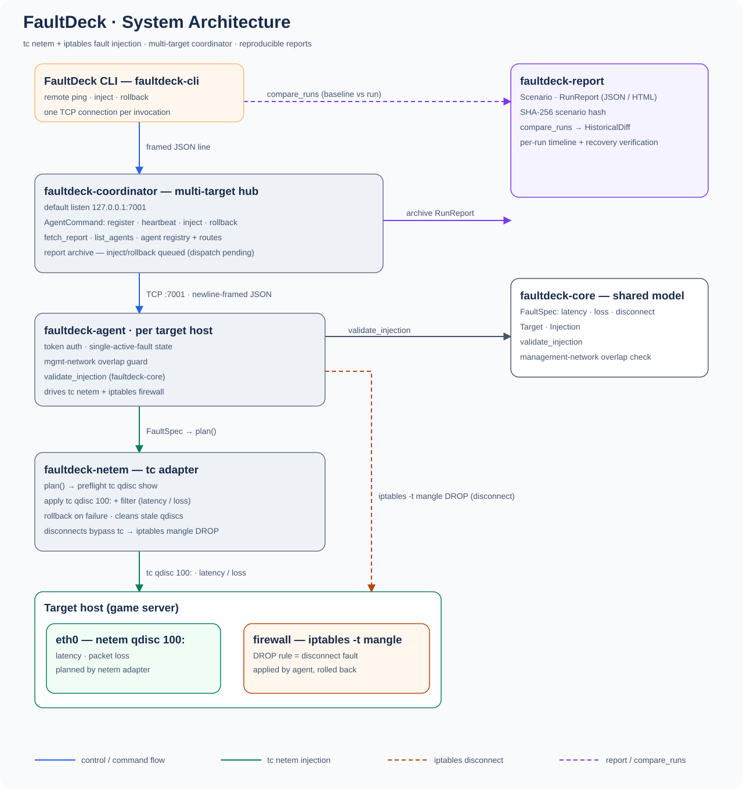

<p align="center"></p>

<p align="center"><a href="LICENSE"></a> <a href="https://www.rust-lang.org"></a> <a href="docs/design/mvp-plan.md"></a> <a href="#"></a> <a href="#"></a></p>

# FaultDeck · Game-Dev-Oriented Fault Simulation & Testing Tool


English · [中文文档](README.zh.md)

<p align="center"></p>

**FaultDeck serves game development testing.** It simulates real-world game network faults — player weak networks, disconnect/reconnect, mid-combat drops, cross-server partition — injects them automatically, verifies that the server recovers correctly, and produces reproducible test reports. The goal: repeatable, automated fault testing instead of manually pulling network cables.

Shipped fault types: latency, packet loss, disconnect (iptables). Blackhole and bandwidth throttle are planned. Faults are composed per target with the CLI today; prebuilt game scenario templates (disconnect-on-room-join and reconnect, combat settlement packet-loss retry, dual-server brain split, Redis/DB timeouts blocking game logic) are on the P2 roadmap. Not bound to KBEngine or any single game server.

AI agents can drive the same chain via MCP: `faultdeck-mcp` (stdio, official rmcp SDK) exposes `list_targets` / `apply_fault` / `clear_fault` / `run_scenario` / `read_report` against the coordinator — same injection backends as the CLI, no separate implementation; only the shipped fault types above have tools.

## Daily Builds

Get the latest rolling build from the **Releases page** (the `nightly` release):

- **https://github.com/cuihairu/faultdeck/releases/tag/nightly**

A new build lands daily (05:17 CST). Choose your asset:

| Asset | Platform | Verify |
|---|---|---|
| `faultdeck-linux-x86_64` | Linux x86_64 | `./faultdeck --version` |
| `faultdeck-linux-aarch64` | Linux ARM64 | `./faultdeck --version` |
| `faultdeck-agent-*` | FaultDeck agent (same platform) | `./faultdeck-agent --version` |
| `faultdeck-coordinator-*` | Coordinator (same platform) | `./faultdeck-coordinator --version` |

Each asset ships with a `.sha256` checksum; the latest build is always the only copy (older builds are replaced, never accumulated). Binaries are unsigned — SmartScreen/Gatekeeper may warn.

## Core Principles

- **The experiment DSL describes fault semantics; the backend decides implementation.** If a backend cannot honor the exact semantics, it returns "unsupported" — never a silent approximation.
- **No reinvented wheels:** the underlying engines are reused — Toxiproxy (TCP proxy), tc netem (Linux), WinDivert (Windows). FaultDeck owns orchestration, safety, and reporting.
- **Reliable rollback is an MVP acceptance gate**, not an afterthought.
- **Safety isolation:** never apply faults to NICs/subnets carrying management traffic (SSH, ZeroTier).

## Architecture

```
faultdeck CLI · faultdeck-mcp (AI agents, stdio) · desktop UI (Tauri)
  └ Rust Experiment Engine
       Scenario Planner / Target Resolver / Safety Guard
       Lifecycle+Rollback / Metrics / Report
       └ Fault Backend Adapters
            ├ tc/netem (Linux, live)         ├ iptables disconnect (live)
            ├ Toxiproxy (TCP, planned)       ├ WinDivert (Windows, planned)
            └ Chaos Mesh (K8s, planned)
```


## Connection Architecture (Three Modes)

### Mode A · Agent Listens (publicly reachable target)


The controller dials into the agent on the target; injection/rollback commands flow down, events and reports flow back.

### Mode B · Controller Listens (target behind NAT)


The agent dials out and reverse-connects; a long-lived tunnel (auto-reconnect) carries commands and reports both ways.

### Mode C · Coordinator (recommended for multi-target)


The coordinator sits where both sides can reach; agents reverse-dial it and hold the link (auto-reconnect, heartbeat), controllers submit experiments via `faultdeck hub`, commands dispatch live down each agent's link and execution results return through it (offline agents' commands queue until they reconnect), and reports are archived centrally; it solves double-NAT and enables a fleet view; in our fleet it can run on top of the meshlet virtual network.

> All three modes share one protocol (command/event/log/report streams); only "who listens, who dials, and whether traffic routes through a coordinator" differs.

## Roadmap

| Phase | Scope | Status |
|---|---|---|
| P0 | Rust CLI + Toxiproxy adapter + experiment YAML + latency/disconnect/blackhole/bandwidth + auto recovery + JSON report (test-driven: game disconnect-reconnect scenario ships first) | Partially shipped — CLI, latency/loss/disconnect, explicit rollback and JSON report live; automatic fault recovery, Toxiproxy adapter, experiment YAML, blackhole/bandwidth pending |
| P1 | tc/netem adapter, TCP/UDP, traffic selection, burst loss, reordering, netns isolation | Partially shipped — tc/netem adapter + traffic selection (src/dst/port) live in `crates/netem`; burst loss, reordering, netns isolation pending |
| P2 | Game weak-network / combat-disconnect / cross-server-partition templates, Wingman API integration, external assertions & reports | Planned |
| P3 | WinDivert, optional desktop UI, multi-target, remote agent, CI integration | Partially shipped — remote agent (`crates/agent`) and CI build/test (`.github/workflows/rust.yml`) live; coordinator registration, live inject/rollback dispatch over agent reverse links, offline queueing, online status and central report archive live; desktop UI (Tauri, `crates/desktop`, platform installers in the nightly assets) live; WinDivert pending |

## Repository Layout

```
crates/ core · netem · agent · cli · report · coordinator · desktop · faultdeck-mcp (protocol/ is an empty placeholder)
docs/   vitepress site (https://cuihairu.github.io/faultdeck/)
```

Planned: toxiproxy adapter crate, scenario YAML DSL, `examples/`, root-level integration tests.

## Docs

- [MVP plan](https://cuihairu.github.io/faultdeck/design/mvp-plan/) · [MVP 计划(中文)](https://cuihairu.github.io/faultdeck/zh/design/mvp-plan/)
- [ChatGPT review archive](docs/review/2026-11-02-chatgpt-faultdeck.md)

## Conventions

- Commits: short English; no force push; tests green before push
- Credentials via env references only, never committed
