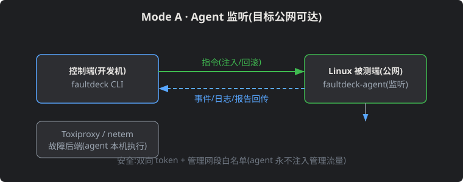
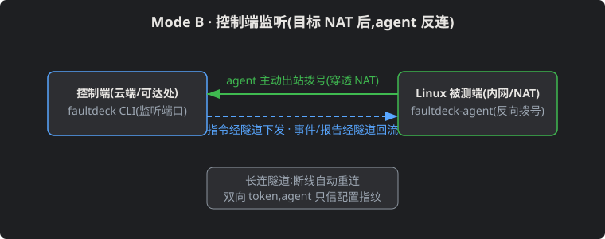
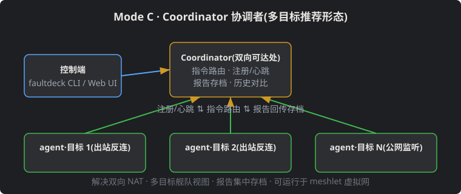

<p align="center"></p>

<p align="center"><a href="LICENSE"></a> <a href="https://www.rust-lang.org"></a> <a href="docs/design/mvp-plan.md"></a> <a href="#"></a> <a href="#"></a></p>

# FaultDeck · Game-Dev-Oriented Fault Simulation & Testing Tool


English · [中文文档](README.zh.md)

**FaultDeck serves game development testing.** It simulates real-world game network faults — player weak networks, disconnect/reconnect, mid-combat drops, cross-server partition — injects them automatically, verifies that the server recovers correctly, and produces reproducible test reports. The goal: repeatable, automated fault testing instead of manually pulling network cables.

Fault types: latency, packet loss, disconnect, blackhole, bandwidth throttle. Scenarios are prebuilt around common game development problems (disconnect-on-room-join and reconnect, combat settlement packet-loss retry, dual-server brain split, Redis/DB timeouts blocking game logic). Not bound to KBEngine or any single game server — but game scenario templates are first-class citizens.

## Core Principles

- **The experiment DSL describes fault semantics; the backend decides implementation.** If a backend cannot honor the exact semantics, it returns "unsupported" — never a silent approximation.
- **No reinvented wheels:** the underlying engines are reused — Toxiproxy (TCP proxy), tc netem (Linux), WinDivert (Windows). FaultDeck owns orchestration, safety, and reporting.
- **Reliable rollback is an MVP acceptance gate**, not an afterthought.
- **Safety isolation:** never apply faults to NICs/subnets carrying management traffic (SSH, ZeroTier).

## Architecture

```
faultdeck CLI (→ optional Web UI)
  └ Rust Experiment Engine
       Scenario Planner / Target Resolver / Safety Guard
       Lifecycle+Rollback / Metrics / Report
       └ Fault Backend Adapters
            ├ Toxiproxy (TCP, 3 platforms)   ├ tc/netem (Linux)
            ├ WinDivert (Windows, P2)        └ Chaos Mesh (K8s, optional)
```


## Connection Architecture (Three Modes)

### Mode A · Agent Listens (publicly reachable target)



The controller dials into the agent on the target; injection/rollback commands flow down, events and reports flow back.

### Mode B · Controller Listens (target behind NAT)



The agent dials out and reverse-connects; a long-lived tunnel (auto-reconnect) carries commands and reports both ways.

### Mode C · Coordinator (recommended for multi-target)



The coordinator sits where both sides can reach; agents register with heartbeats, controllers attach and launch experiments; commands are routed and reports archived centrally; solves double-NAT and enables a fleet view; in our fleet it can run on top of the meshlet virtual network.

> All three modes share one protocol (command/event/log/report streams); only "who listens, who dials, and whether traffic routes through a coordinator" differs.

## Roadmap

| Phase | Scope | Status |
|---|---|---|
| P0 | Rust CLI + Toxiproxy adapter + experiment YAML + latency/disconnect/blackhole/bandwidth + auto recovery + JSON report (test-driven: game disconnect-reconnect scenario ships first) | Not started |
| P1 | tc/netem adapter, TCP/UDP, traffic selection, burst loss, reordering, netns isolation | Partially shipped — tc/netem adapter + traffic selection (src/dst/port) live in `crates/netem`; burst loss, reordering, netns isolation pending |
| P2 | Game weak-network / combat-disconnect / cross-server-partition templates, Wingman API integration, external assertions & reports | Planned |
| P3 | WinDivert, optional Web UI, multi-target, remote agent, CI integration | Planned |

## Repository Layout (target)

```
crates/ faultdeck-core · scenario · backend · toxiproxy · netem
        safety · report · cli
examples/ tcp-reconnect.yaml · lost-packet-retry.yaml · network-partition.yaml
tests/   integration/ · recovery/
```

## Docs

- [MVP plan](https://cuihairu.github.io/faultdeck/design/mvp-plan/) · [MVP 计划(中文)](https://cuihairu.github.io/faultdeck/zh/design/mvp-plan/)
- [ChatGPT review archive](docs/review/2026-11-02-chatgpt-faultdeck.md)

## Conventions

- Commits: short English; no force push; tests green before push
- Credentials via env references only, never committed
