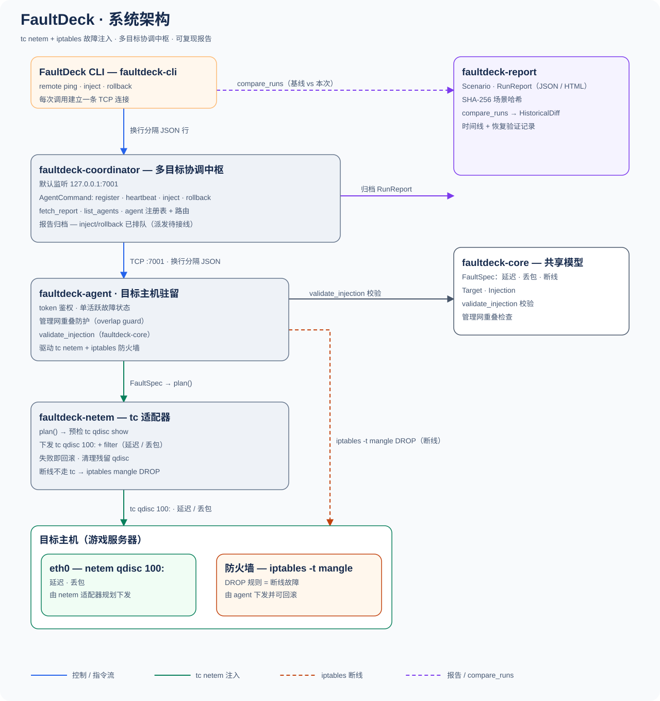
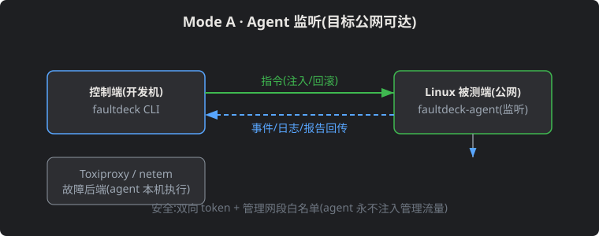
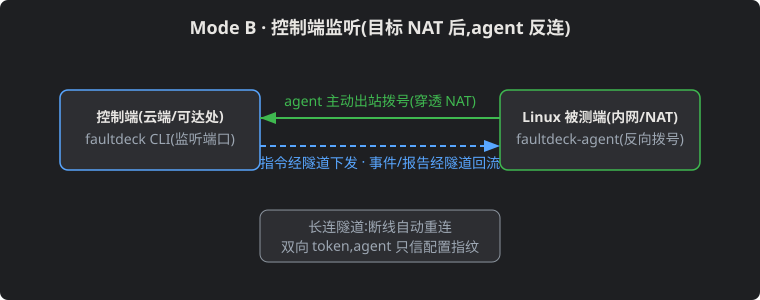
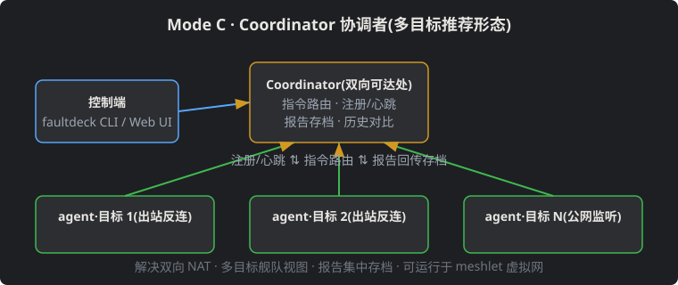

<p align="center"></p>

<p align="center"><a href="LICENSE"></a> <a href="https://www.rust-lang.org"></a> <a href="docs/zh/design/mvp-plan.md"></a> <a href="#"></a> <a href="#"></a></p>

# FaultDeck · 面向游戏开发场景的故障模拟与测试工具


[English](README.md) · 中文

<p align="center"></p>


**定位:为游戏开发测试服务。** 模拟玩家弱网、断线重连、战斗中掉线、跨服网络隔离等游戏开发中真实会遇到的网络故障,自动注入、自动验证服务端能否正确恢复,生成可复现的测试报告——目的是让故障测试可重复、可自动化,替代人肉拔网线。

已实现的故障类型:延迟、丢包、断连(iptables)。黑洞与带宽限制在计划中。故障目前通过 CLI 按目标逐条下发;进房断网重连、战斗结算丢包重试、双服脑裂、Redis/DB 超时阻塞游戏逻辑等预置游戏场景模板在 P2 路线图。不绑定 KBEngine 或单一游戏服务器。

AI agent 可经 MCP 驱动同一条链路:`faultdeck-mcp`(stdio,官方 rmcp SDK)面向 coordinator 暴露 `list_targets` / `apply_fault` / `clear_fault` / `run_scenario` / `read_report` ——与 CLI 共用同一套注入后端,MCP 层零第二套实现;仅上述已实现故障类型有对应工具。

## 每日构建

最新滚动构建请到 **Releases 页**(`nightly` 发布)获取:

- **https://github.com/cuihairu/faultdeck/releases/tag/nightly**

每天 05:17(北京时间)落一个新构建。按平台选择资产:

| 资产 | 平台 | 验证 |
|---|---|---|
| `faultdeck-linux-x86_64` | Linux x86_64 | `./faultdeck --version` |
| `faultdeck-linux-aarch64` | Linux ARM64 | `./faultdeck --version` |
| `faultdeck-agent-*` | 代理(同平台) | `./faultdeck-agent --version` |
| `faultdeck-coordinator-*` | 协调器(同平台) | `./faultdeck-coordinator --version` |

每个资产附带 `.sha256` 校验和;只保留最新一份构建(旧的会被替换,不会累积)。二进制未签名——SmartScreen/Gatekeeper 可能告警。

## 核心理念

- **实验 DSL 描述故障语义,Backend 决定实现方式**;Backend 不支持精确语义时返回「不支持」,不做静默近似
- **不重造轮子**:底层引擎复用而非重造——tc netem(Linux)已用;Toxiproxy(TCP 代理)与 WinDivert(Windows)为计划引擎。FaultDeck 做编排、安全与报告
- **可靠撤销是 MVP 硬性验收条件**,不是事后补丁
- **安全隔离**:绝不把故障施加到承载 SSH/ZeroTier 管理流量的网卡

## 架构

```
faultdeck CLI · faultdeck-mcp(AI agent,stdio) · 桌面 UI(Tauri)
  └ Rust Experiment Engine
       Scenario Planner / Target Resolver / Safety Guard
       Lifecycle+Rollback / Metrics / Report
       └ Fault Backend Adapters
            ├ tc/netem(Linux,已实现)      ├ iptables 断连(已实现)
            ├ Toxiproxy(TCP,计划中)      ├ WinDivert(Windows,计划中)
            └ Chaos Mesh(K8s,计划中)
```


## 连接架构(三种模式)

### Mode A · Agent 监听(目标公网可达)



控制端主动拨入目标上的 agent;注入与回滚指令下发,事件与报告回传。

### Mode B · 控制端监听(目标 NAT 后)



agent 主动出站反向拨号,长连隧道(断线自动重连),指令与报告经隧道双向流动。

### Mode C · Coordinator 协调者(多目标推荐形态)



协调者部署在双向可达处;agent 主动反向拨号并维持链路(断线重连+心跳),控制端经 `faultdeck hub` 提交实验,指令沿各 agent 链路在线下发、执行结果原路回传(离线 agent 的指令入队,重连后自动补发),报告集中存档;解决双向 NAT,支持多目标舰队视图;舰队场景可运行于 meshlet 虚拟网之上。

> 三种模式共用同一套协议(指令/事件/日志/报告流),差异仅在「谁监听、谁拨号、是否经协调者路由」。

## 路线图

| 阶段 | 内容 | 状态 |
|---|---|---|
| P0 | Rust CLI + Toxiproxy Adapter + 实验 YAML + 延迟/断线/黑洞/带宽 + 自动恢复 + JSON 报告(测试导向:游戏断线重连场景首发) | 部分落地——CLI、延迟/丢包/断连、显式回滚与 JSON 报告已实现;故障自动恢复、Toxiproxy Adapter、实验 YAML、黑洞/带宽待做 |
| P1 | tc/netem Adapter、TCP/UDP、流量选择、突发丢包、乱序、netns 隔离 | 部分落地——tc/netem Adapter 与流量选择(源/目的/端口)已实现(`crates/netem`);突发丢包、乱序、netns 隔离待做 |
| P2 | 游戏弱网/战斗断线/跨服隔离模板,集成 Wingman API、外部断言与报告 | 待 P1 |
| P3 | WinDivert、可选桌面 UI、多目标、远程 Agent、CI 集成 | 部分落地——远程 Agent(`crates/agent`)与 CI 构建/测试(`.github/workflows/rust.yml`)已实现;Coordinator 注册、经 agent 反向链路的在线 inject/rollback 下发、离线入队补发、在线状态与报告集中存档已实现;桌面 UI(Tauri,`crates/desktop`)已实现,目前仅为源码构建——尚未发布预编译安装器,nightly 构建排除了该 crate;WinDivert 待做 |

## 仓库结构

```
crates/ core · netem · agent · cli · report · coordinator · desktop · faultdeck-mcp(protocol/ 为空占位)
docs/   vitepress 站点(https://cuihairu.github.io/faultdeck/)
```

计划中:toxiproxy adapter crate、场景 YAML DSL、`examples/`、根级集成测试。

## 文档

- [ChatGPT 评审存档](docs/review/2026-11-02-chatgpt-faultdeck.md)
- [MVP 计划](https://cuihairu.github.io/faultdeck/design/mvp-plan/)
